<div align="center">



# SOLARIS
### An interactive 3D journey through the Solar System

Explore the Sun, eight planets, and their surroundings in a cinematic, browser-based experience powered by **Three.js**.

**[Get started](#quick-start)** · **[Explore features](#highlights)** · **[Controls](#controls)** · **[Customize](#customization)**

</div>

---

## At a glance

**SOLARIS** is a no-build, single-page Solar System visualization. Fly between worlds, inspect planetary information, and follow animated orbits through a star-filled scene. It runs entirely in your browser using HTML, CSS, JavaScript, and WebGL.

> [!NOTE]
> The scene is **illustrative, not scientifically to scale**. Planet sizes, distances, orbit shapes, and simulation timing are deliberately adjusted for readability. The animated banner above is also an artistic illustration.

## Highlights

| Experience | What you can do |
| --- | --- |
| 🌞 **Solar System exploration** | Visit the Sun and all eight planets, from Mercury to Neptune. |
| 🪐 **Animated celestial bodies** | Watch planetary orbits, axial rotation, and selected moons in motion. |
| ✨ **Rich space visuals** | See procedural textures, a glowing Sun, planetary atmospheres, Earth cloud layers, Saturn's rings, and a starfield. |
| 🚀 **Cinematic camera** | Click on a celestial body or use the navigation dock to smoothly fly to it. |
| 📖 **Planet information** | Explore descriptions and statistics including size, day length, and orbital period. |
| ⏱️ **Time controls** | Adjust simulation speed, pause or resume motion, and view elapsed simulated Earth years. |
| 🌌 **Scene overlays** | Show or hide orbit paths, labels, the asteroid belt, and Kuiper-belt particles with the belt toggle. |
| 📱 **Responsive navigation** | Explore with a mouse, keyboard, or supported touch gestures. |

## Quick start

**Requirements:** A modern browser with WebGL support, an internet connection to fetch Three.js from the CDN, and Python 3 (or another local HTTP server).

```bash
git clone https://github.com/shreeharsh-patil/Solar-System.git
cd Solar-System
python3 -m http.server 8000
```

Open **http://localhost:8000** in your browser.

On Windows, you can use `py -m http.server 8000` if `python3` is unavailable. There is **no npm install, build step, or API key**.

> [!TIP]
> Use a local server instead of opening `index.html` with `file://`. The page imports Three.js as ES modules from a CDN and works best when served over HTTP.

## Controls

| Action | Input |
| --- | --- |
| Orbit the camera | Click or touch and drag |
| Zoom in / out | Scroll wheel or pinch gesture |
| Select an object | Click a celestial body or use the bottom dock |
| Next / previous world | `→` / `←` |
| Pause / resume | `Space` or the Pause/Play button |
| Return to the Solar System overview | `Esc` or **Overview** in the dock |
| Change time speed | **Time speed** slider |
| Hide / show visual guides | **Orbits**, **Labels**, and **Asteroid belts** switches |

## How it works

The scene is built in `index.html` using Three.js and its `OrbitControls` module:

1. **Scene generation:** Stars, the Sun, planets, moons, and belts are assembled into a Three.js scene.
2. **Planet appearance:** JavaScript generates surface textures procedurally; materials and shaders produce features such as solar activity and atmospheric glow.
3. **Orbital movement:** A `requestAnimationFrame` loop updates planet and moon positions, rotations, elapsed simulated time, and subtle background effects.
4. **Camera navigation:** The camera eases toward the selected object and follows it as it moves through its orbit.
5. **Information UI:** The bottom dock and detail panel surface each body's description and statistics.

The simulation speed slider eases between selected speeds for a smoother transition; pausing also freezes the animated solar surface. Motion-reduction preferences are respected by the loading animation and the README banner.

## Project structure

```text
Solar-System/
├── index.html                 # Scene, renderer, shaders, styles, and interface
├── assets/
│   └── solaris-orbits.svg     # Lightweight animated README banner
└── README.md                  # Project documentation
```

## Customization

- **Planet data:** Edit the `PLANETS` array in `index.html` to change descriptions, display colors, orbital periods, dimensions, or moon configurations.
- **Solar facts:** Edit `SUN_DATA` to update the information panel for the Sun.
- **Materials:** Look in `GEN` for the procedural planetary texture functions, and the shader sections for glow and lighting effects.
- **Visual theme:** Adjust the CSS variables near the beginning of `index.html` (such as `--bg`, `--accent`, and `--accent2`).
- **README animation:** Edit `assets/solaris-orbits.svg`. It uses vector shapes and CSS keyframes, no JavaScript or third-party animation assets. Users who prefer reduced motion see a static composition.

## Troubleshooting

| Problem | Check |
| --- | --- |
| Blank or black canvas | Confirm that WebGL/hardware acceleration is enabled and your browser supports WebGL. Inspect the developer console. |
| Three.js import fails | Check your internet connection and access to `unpkg.com`. |
| `file://` issues | Serve the repository with `python3 -m http.server 8000` instead. |
| Low frame rate | Close other graphics-intensive tabs or try a device with stronger graphics support; complex procedural visuals can be demanding. |
| Banner does not move | Your browser may limit animation in SVG images, or a reduced-motion setting may be active. The static banner remains readable. |

## Built with

**HTML5** · **CSS3** · **JavaScript (ES modules)** · **[Three.js](https://threejs.org/)** · **WebGL**

---

<div align="center">

**Explore the universe, one planet at a time.**

[Back to top ↑](#solaris)

</div>
